# Paint by Numbers

Turns a picture into a plan for painting it in layers of Golden Heavy Body acrylics, over a background you choose. It picks the paints, the order to apply them, and how thick each one goes where. Layers are added for as long as they improve the match, and a paint can appear in more than one layer.

## How it works

A digital color image is stored as three grayscale pictures, called channels: one each for red, green and blue light. In the red channel, a bright pixel means a lot of red light at that spot and a dark pixel means little. The screen mixes the three channels back into the colors you see.

Paint by Numbers does the same thing with paint. Instead of red, green and blue light, it uses a handful of real paints, and for each paint it makes a grayscale picture called a **layer map**:

- **Black** means none of that paint here.
- **White** means the thickest application (2 full coats by default).
- **Grays in between** mean thinner coats, painted as glazes thinned with clear medium. Each gray value matches a specific mix; see [Thickness levels](#thickness-levels).

Paint the layers one on top of another, bottom layer first, and the picture comes back.

One big difference from light: color channels simply add up, but paint layers **stack**. Each layer covers or tints whatever is beneath it. Opaque paints hide what is below them, and transparent paints act like colored glass. That is why the order of the layers matters, and why the same paint can be useful in two different layers.

To see what each layer should look like, every layer also gets a **swatch**: its paint at full strength and at each thickness the layer uses, over white and over black.

The full design is in `docs/paint-by-numbers-spec.md`.

## Example

| Photo | Planned painting |
| --- | --- |
| 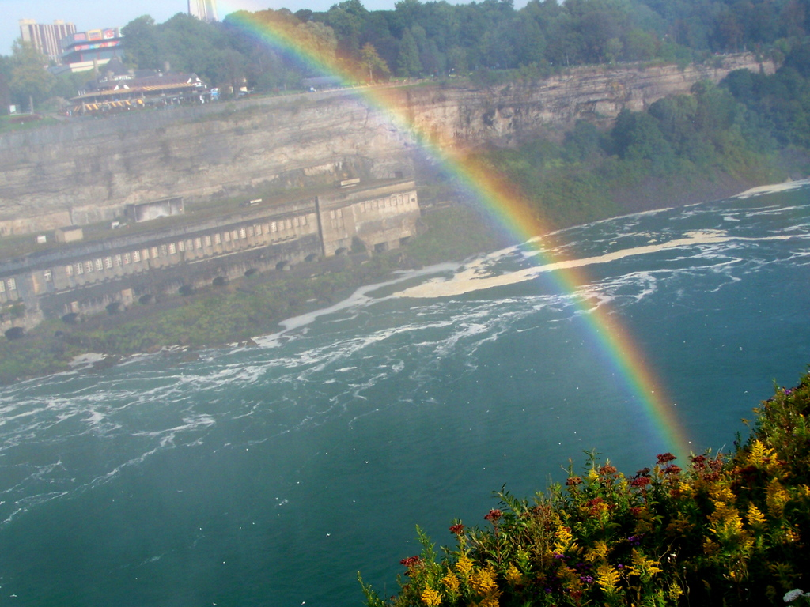 | 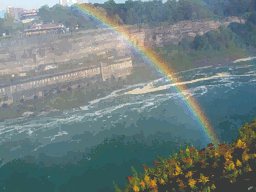 |

```
paint-by-numbers docs/examples/rainbow/rainbow.jpg --out out/rainbow
```

With default settings (white background, choosing from 116 paints, 256 px) the planner picks six layers, mean color error 4.7 ΔE. Below, bottom layer first: each paint with its layer map (white is where it goes thickest) and its swatch (each thickness the layer uses, over white and over black, then full strength).

| # | Paint and layer map | Swatch |
| --- | --- | --- |
| 1 | **Cadmium Yellow Medium Hue**<br>semi-opaque, covers 20%<br>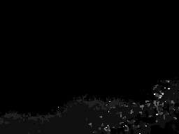 | 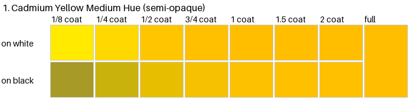 |
| 2 | **Raw Umber**<br>opaque, covers 63%<br>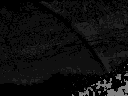 | 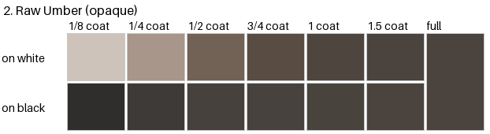 |
| 3 | **Azurite Hue**<br>semi-transparent, covers 87%<br>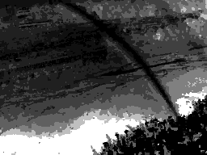 | 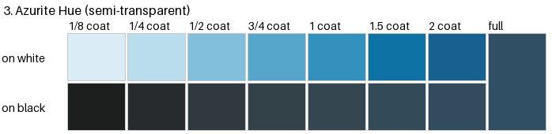 |
| 4 | **Nickel Azo Yellow**<br>transparent, covers 49%<br> | 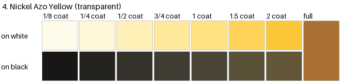 |
| 5 | **Bone Black**<br>semi-opaque, covers 73%<br>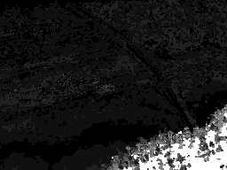 | 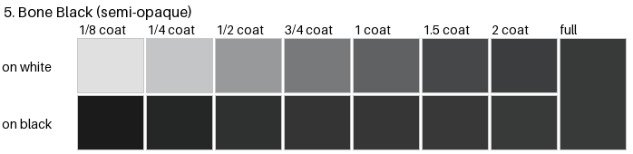 |
| 6 | **Quinacridone Violet**<br>transparent, covers 46%<br>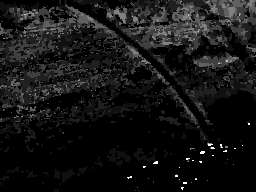 | 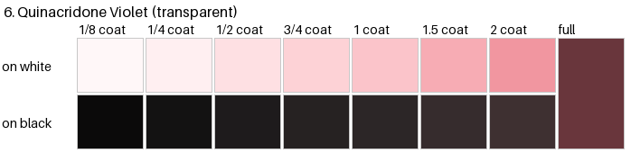 |

The overview puts each layer's swatch, each layer on its own, and the painting after each layer on one sheet, with the photo, the preview and the color error at the bottom:

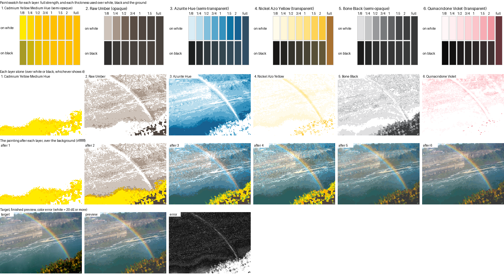

<details>
<summary>Each thickness as its own layer (thickness_overview.png)</summary>

For every layer: its swatch, then each thickness on its own; below, the painting before the layer and after each thickness is applied.

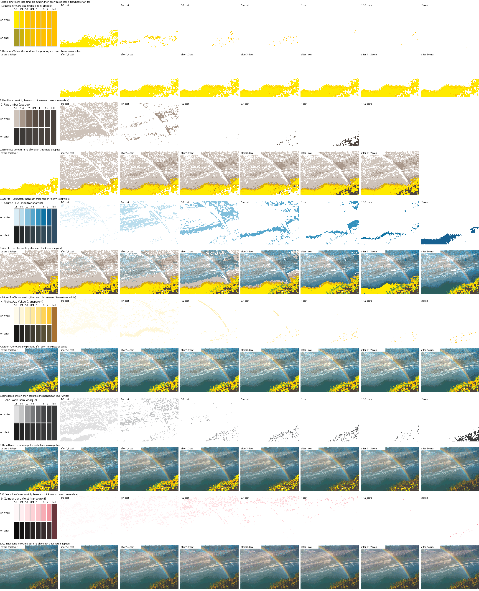

</details>

Fewer thicknesses per layer give simpler regions to paint, at some cost in accuracy:

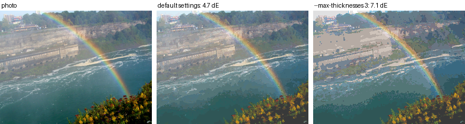

All outputs of this run are in [`docs/examples/rainbow`](docs/examples/rainbow): layer maps, swatches, overviews and `recipe.json`.

Photo: ["Rainbow"](https://www.flickr.com/photos/andyarthur/6195212880/) by [andyarthur](https://www.flickr.com/photos/andyarthur/), licensed under [CC BY 2.0](https://creativecommons.org/licenses/by/2.0/). The preview, layer maps, swatches and overview sheets are derived from it by this program (resized to 256 px and turned into a paint plan).

## Setup

```
git clone https://github.com/ADMoreau/paint-by-numbers.git
cd paint-by-numbers
python3 -m venv .venv
.venv/bin/pip install torch --index-url https://download.pytorch.org/whl/cpu
.venv/bin/pip install -e ".[test]"
```

It runs on a laptop CPU. The planner works offline; paint data is in `paint_by_numbers/data/paints_heavy_body.json`.

The database holds all 129 Golden Heavy Body colors that publish color data (27 special-effect products without it, such as interference, iridescent and mica colors, are skipped). By default the planner chooses from the 116 current, non-fluorescent ones; the 4 discontinued and 9 fluorescent/phosphorescent paints are used only when named in `--paints`.

## Usage

```
.venv/bin/paint-by-numbers input.jpg --out out/
```

(`.venv/bin/python -m paint_by_numbers.cli` does the same.) In a terminal, each layer in the summary is shown with colored blocks of its paint.

Common options:

| Option | Meaning |
| --- | --- |
| `--background "#7A6A58"` | Background color (hex or `R,G,B`). Default white. |
| `--background-paint "Burnt Umber"` | Start from an opaque ground coat of a database paint (recorded as layer 0). |
| `--background-image ground.png` | A per-pixel background, such as a photo of an underpainting. |
| `--paints "Titanium White,Ultramarine Blue,..."` | Only use these paints. Names ignore case. Default: every current, non-fluorescent paint. |
| `--paints-file my_palette.txt` | Same, from a text file: one paint per line (or comma-separated), `#` for comments. Combines with `--paints`. |
| `--max-paints N` | Use at most N different paints; the planner picks the best set. A paint can still appear in several layers. |
| `--max-layers N` | Cap the number of layers. Default: no cap. |
| `--min-gain 0.5` | How much a new layer must improve the match (RMS ΔE) to be added. Lower adds more layers. |
| `--size 256` | Working size, long side in pixels. |
| `--levels 0,0.25,0.5,1,2` and `--t-max 2` | Allowed thicknesses in coats, and the maximum per layer. |
| `--max-thicknesses N` | Each layer uses at most N different thicknesses, so it has fewer regions to paint. Default: no limit. |
| `--smoothing 2` | Keeps each thickness region in one piece instead of scattered specks. Higher is smoother but less exact; 0 turns it off. |
| `--breakdown thickness` | How each layer is broken down further: `thickness` (default) shows each thickness as its own layer, `passes` shows nested coats, `both`, or `none`. |
| `--steps`, `--lam-smooth`, `--lam-paint` | Solver tuning. See `--help`. |

Only one background option can be given.

The example above took about 2 minutes on an 8-thread laptop CPU. Restricting `--paints` to a few makes it faster. Run time grows with image size, layer count and paint count; there is no time limit.

## Outputs

| File | What it is |
| --- | --- |
| `layers/01_<paint>.png`, `02_...` | One per layer, bottom layer first. Black is no paint, white is the maximum (`--t-max`, default 2 coats). |
| `layers_color/01_<paint>.png`, ... | The same layer in color: that paint alone at its thicknesses, over white or black (whichever shows it more clearly; `recipe.json` says which). |
| `steps/01_<paint>.png`, ... | The painting after each layer over your background, so you can see it build up. The last step is the finished painting. |
| `swatches/01_<paint>.png`, ... | What each layer's paint should look like: full strength, and each thickness the layer uses over white, over black and over your background (if it is a flat color other than white or black). `recipe.json` lists the same colors as hex. |
| `overview.png` | One sheet with every layer's swatch, every layer alone, every step, and the target, preview and error map. Start here. |
| `thickness/01_<paint>_0.125coats.png`, ... | Each thickness of a layer as its own layer: the area painted at exactly that thickness, in color. With it, `..._mask.png` (white = paint here) and `..._after.png` (the painting once it is applied). The areas don't overlap, so each spot gets one treatment; `recipe.json` gives each one's glaze mix and area. |
| `thickness_overview.png` | For every layer: its swatch and each thickness on its own, then the painting before the layer and after each thickness is applied. |
| `passes/01_<paint>_pass1.png`, ... | With `--breakdown passes`: each layer broken into uniform coats of its paint. Pass 1 covers everywhere the layer goes; each later pass lies inside the one before and builds it thicker. White marks where the pass goes; `recipe.json` gives its coats and glaze mix. Painted in order, the passes add up exactly to the layer. |
| `passes_overview.png` | With `--breakdown passes`: every pass in color, one row per layer. |
| `preview.png` | The simulated finished painting over the background. |
| `error.png` | Per-pixel color error between preview and image. Black is a perfect match; white is 20 ΔE or worse. |
| `recipe.json` | Background, layer order, paint per layer, how much area gets each thickness, how to paint each thickness level, color error, and notes. |

### Thickness levels

Thickness levels and their gray values in the layer maps, with the default `--t-max 2`:

| Coats | Gray value | How to paint it |
| --- | --- | --- |
| 0.125 | 16 | 1 coat of 1 part paint to 7 parts medium |
| 0.25 | 32 | 1 coat of 1 part paint to 3 parts medium |
| 0.5 | 64 | 1 coat of 1 part paint to 1 part medium |
| 0.75 | 96 | 1 coat of 3 parts paint to 1 part medium |
| 1 | 128 | 1 full coat |
| 1.5 | 191 | 1 full coat + 1 coat of 1:1 paint to medium |
| 2 | 255 | 2 full coats |

A fraction of a coat can be painted as a glaze because, in the paint model, diluting with clear medium is the same as a thinner layer.

## Adding paints

The database already has the whole Heavy Body line. To refresh it from Golden's site (for example after new colors are released), or to add single paints by name, then refit:

```
.venv/bin/python scripts/fetch_golden.py --all --cache pages/
.venv/bin/python scripts/fetch_golden.py "Burnt Sienna"
.venv/bin/python -m paint_by_numbers.fit
```

The fetch script makes one request per paint (`--all` is about 156), and only when you run it. Pages without color data are reported as skipped.

## Known limits

- **Three-channel paint model.** Kubelka-Munk on red, green and blue only approximates real paint; some mixtures will be off in hue.
- **Tints of strong transparent paints can be off in hue.** K and S are fitted from each paint's published full-strength color only. Phthalo Blue's full strength is very dark with a slight red cast, so its tints with white come out lavender instead of cyan. The planned fix is fitting each paint to the tint and glaze swatch on its product page (the image links are already stored in the database).
- **Hiding power is estimated.** Each transparency rating is mapped to how many coats hide a black-and-white chart (opaque 1, semi-opaque 2, semi-transparent 5, transparent 20). That table is the least certain part of the model; it lives in `paint_by_numbers/fit.py` as `COATS_TO_HIDE`.
- **Fluorescent and phosphorescent paints are not modeled.** They emit light (Fluorescent Chartreuse's published L\* is 106, brighter than white), so a reflectance model cannot reproduce them. They are left out unless named in `--paints`.
- **Wide-gamut model, sRGB files.** Paint is modeled in linear Rec.2020, which holds every non-fluorescent Golden paint (cadmium yellows, cobalt teals). Input images and `preview.png` are sRGB, so a preview cannot show colors more saturated than a screen's sRGB; the color error is measured in Lab and is not affected.
- **Some colors are unreachable.** Saturated screen colors, and anything darker than Carbon Black (L\* 25), cannot be painted with these paints. `error.png` shows where.
- **Rounding to thickness levels costs accuracy.** Smooth gradients show banding. Fine texture in the image becomes many small regions; `--smoothing` and `--max-thicknesses` trade accuracy for fewer, larger regions. On the test render, smoothing 2 cut the number of separate regions by about 80% for 0.3 ΔE.
- **Sheen is not modeled.** When the paints used have different sheens, `recipe.json` suggests a final varnish.
- **Illuminant.** Golden's L\*a\*b\* values are taken as D65, 2°. Golden's own sRGB and Lab agree under D65 within 0.5 ΔE for every paint in the database.

## Development

```
.venv/bin/python -m pytest        # about 3 minutes
```

| Module | Role |
| --- | --- |
| `paint_by_numbers/color.py` | sRGB, working space (linear Rec.2020), XYZ, Lab conversions (torch, differentiable) |
| `paint_by_numbers/km.py` | Kubelka-Munk layer, stack renderer, mixing |
| `paint_by_numbers/paints.py` | Paint database load/save and name lookup |
| `paint_by_numbers/fit.py` | K and S per paint from published data |
| `paint_by_numbers/palette.py` | Paint selection and layer order |
| `paint_by_numbers/solve.py` | Thickness optimizer and quantization |
| `paint_by_numbers/plan.py` | End-to-end pipeline and output files |
| `paint_by_numbers/cli.py` | Command line |
| `scripts/fetch_golden.py` | Adds paints from Golden's product pages (build time only) |

## Prototypes

`prototypes/x_tracking/` is a simulation of how a phone app could keep a guide image locked to the canvas, using small hand-drawn X marks the camera recognizes, even close up. See its [README](prototypes/x_tracking/README.md) for findings. It needs OpenCV: `pip install -e ".[tracking]"`.

## License

MIT. See `LICENSE`.

The example photo in `docs/examples/rainbow/` is not covered by the MIT license: it is "Rainbow" by andyarthur, [CC BY 2.0](https://creativecommons.org/licenses/by/2.0/).
