# Paint by Numbers

Turns a picture into a plan for painting it in layers of Golden Heavy Body acrylics, over a background you choose. It picks the paints, the order to apply them, and how thick each one goes where. Layers are added for as long as they improve the match (or you set how many with `--layers`), and a paint can appear in more than one layer.

## How it works

A digital color image is stored as three grayscale pictures, called channels: one each for red, green and blue light. In the red channel, a bright pixel means a lot of red light at that spot and a dark pixel means little. The screen mixes the three channels back into the colors you see.

Paint by Numbers does the same thing with paint. Instead of red, green and blue light, it uses a handful of real paints, and for each paint it makes a grayscale picture called a **layer map**:

- **Black** means none of that paint here.
- **White** means the thickest application (2 full coats by default).
- **Grays in between** mean thinner coats, painted as glazes thinned with clear medium. Each gray value matches a specific mix; see [Thickness levels](#thickness-levels).

Paint the layers one on top of another, bottom layer first, and the picture comes back.

One big difference from light: color channels simply add up, but paint layers **stack**. Each layer covers or tints whatever is beneath it. Opaque paints hide what is below them, and transparent paints act like colored glass. That is why the order of the layers matters, and why the same paint can be useful in two different layers.

To see what each layer should look like, every layer also gets a **swatch**: its paint at full strength and at each thickness the layer uses, over white and over black.

The full design is in `docs/paint-by-numbers-spec.md`.

## Example

| Photo | Planned painting |
| --- | --- |
| 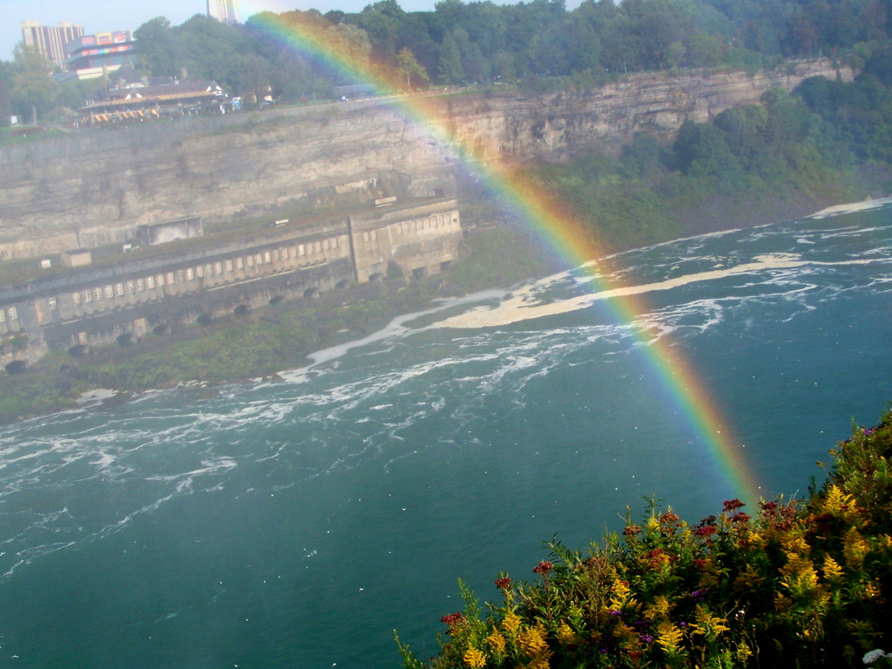 | 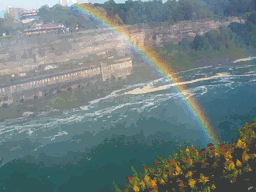 |

```
paint-by-numbers docs/examples/rainbow/rainbow.jpg --out out/rainbow
```

With default settings (white background, choosing from 116 paints, 256 px) the planner picks six layers, mean color error 4.7 ΔE. Below, bottom layer first: each paint with its layer map (white is where it goes thickest) and its swatch (each thickness the layer uses, over white and over black, then full strength).

| # | Paint and layer map | Swatch |
| --- | --- | --- |
| 1 | **Cadmium Yellow Medium Hue**<br>semi-opaque, covers 20%<br>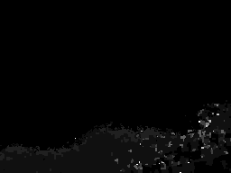 | 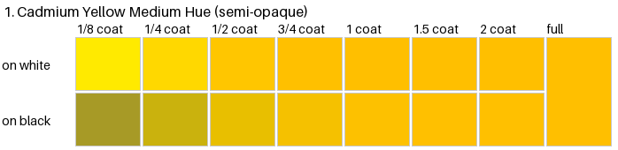 |
| 2 | **Raw Umber**<br>opaque, covers 63%<br>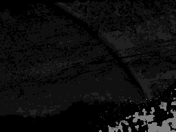 | 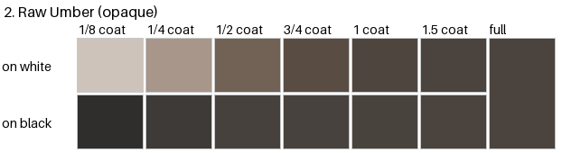 |
| 3 | **Azurite Hue**<br>semi-transparent, covers 87%<br>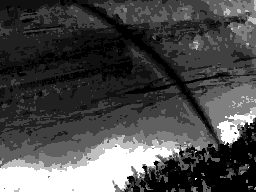 | 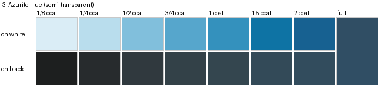 |
| 4 | **Nickel Azo Yellow**<br>transparent, covers 49%<br>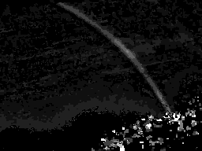 | 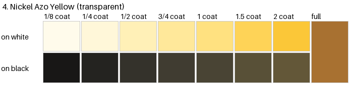 |
| 5 | **Bone Black**<br>semi-opaque, covers 73%<br>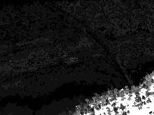 | 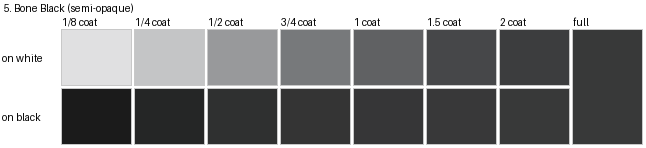 |
| 6 | **Quinacridone Violet**<br>transparent, covers 46%<br>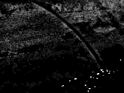 | 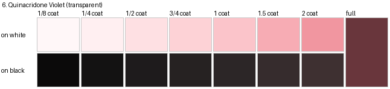 |

The overview puts each layer's swatch, each layer on its own, and the painting after each layer on one sheet, with the photo, the preview and the color error at the bottom:

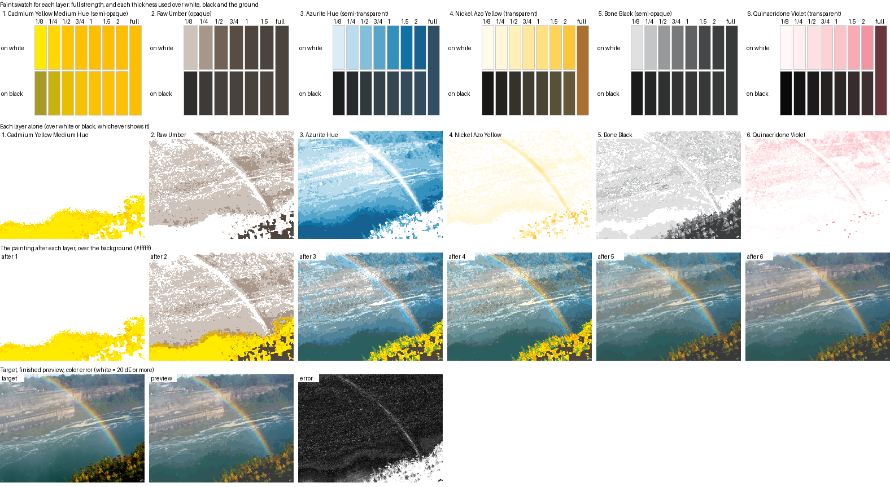

<details>
<summary>Each thickness as its own layer (thickness_overview.png)</summary>

For every layer: its swatch, then each thickness on its own; below, the painting before the layer and after each thickness is applied.

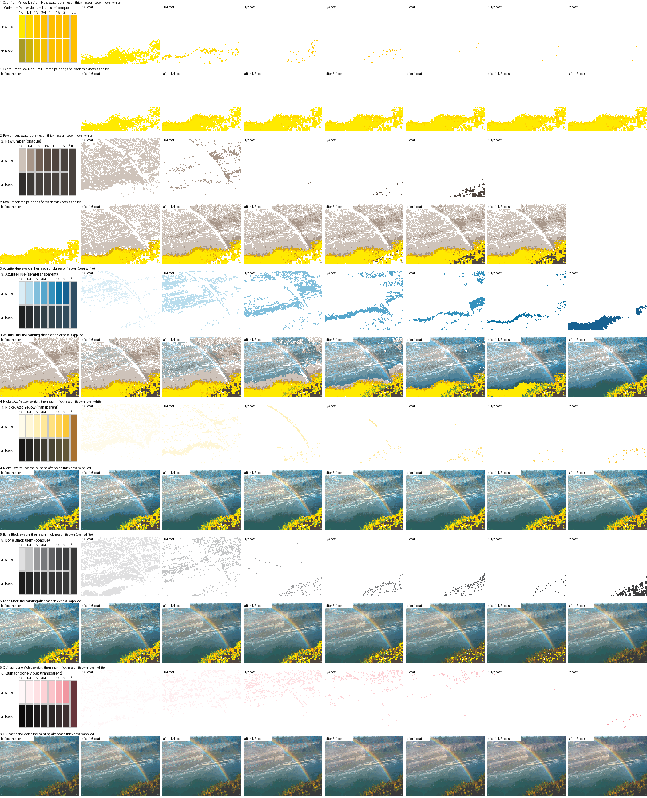

</details>

Fewer thicknesses per layer give simpler regions to paint, at some cost in accuracy:

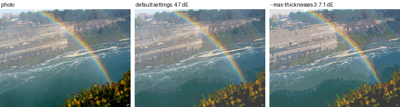

All outputs of this run are in [`docs/examples/rainbow`](docs/examples/rainbow): layer maps, swatches, overviews and `recipe.json`.

Photo: ["Rainbow"](https://www.flickr.com/photos/andyarthur/6195212880/) by [andyarthur](https://www.flickr.com/photos/andyarthur/), licensed under [CC BY 2.0](https://creativecommons.org/licenses/by/2.0/). The preview, layer maps, swatches and overview sheets are derived from it by this program (resized to 256 px and turned into a paint plan).

## Setup

```
git clone https://github.com/ADMoreau/paint-by-numbers.git
cd paint-by-numbers
python3 -m venv .venv
.venv/bin/pip install torch --index-url https://download.pytorch.org/whl/cpu
.venv/bin/pip install -e ".[test]"
```

It runs on a laptop CPU. The planner works offline; paint data is in `paint_by_numbers/data/paints_heavy_body.json`.

The database holds all 129 Golden Heavy Body colors that publish color data (27 special-effect products without it, such as interference, iridescent and mica colors, are skipped). By default the planner chooses from the 116 current, non-fluorescent ones; the 4 discontinued and 9 fluorescent/phosphorescent paints are used only when named in `--paints`.

## Usage

```
.venv/bin/paint-by-numbers input.jpg --out out/
```

(`.venv/bin/python -m paint_by_numbers.cli` does the same.) In a terminal, each layer in the summary is shown with colored blocks of its paint.

Common options:

| Option | Meaning |
| --- | --- |
| `--background "#7A6A58"` | Background color (hex or `R,G,B`). Default white. |
| `--background-paint "Burnt Umber"` | Start from an opaque ground coat of a database paint (recorded as layer 0). |
| `--background-image ground.png` | A per-pixel background, such as a photo of an underpainting. |
| `--paints "Titanium White,Ultramarine Blue,..."` | Only use these paints. Names ignore case. Default: every current, non-fluorescent paint. |
| `--paints-file my_palette.txt` | Same, from a text file: one paint per line (or comma-separated), `#` for comments. Combines with `--paints`. |
| `--max-paints N` | Use at most N different paints; the planner picks the best set. A paint can still appear in several layers. |
| `--layers N` | Paint in exactly N layers, each one paint at one weight over one region. Easier to paint; see [One weight per layer](#one-weight-per-layer). |
| `--max-layers N` | Without `--layers`: cap the number of layers. Default: no cap. |
| `--min-gain 0.5` | How much a new layer must improve the match (RMS ΔE) to be added. Lower adds more layers. |
| `--size 256` | Working size, long side in pixels. |
| `--levels 0,0.25,0.5,1,2` and `--t-max 2` | Allowed thicknesses in coats, and the maximum per layer. With `--layers`, the weights a layer may be painted at. |
| `--max-thicknesses N` | Each layer uses at most N different thicknesses, so it has fewer regions to paint. Default: no limit. |
| `--smoothing 2` | Keeps each thickness region in one piece instead of scattered specks. Higher is smoother but less exact; 0 turns it off. |
| `--breakdown thickness` | How each layer is broken down further: `thickness` (default) shows each thickness as its own layer, `passes` shows nested coats, `both`, or `none`. |
| `--steps`, `--lam-smooth`, `--lam-paint` | Solver tuning. See `--help`. |

Only one background option can be given.

### One weight per layer

By default each layer gets a thickness map with several weights, so at the easel you paint patches of different dilutions next to each other. Closing the gaps where they meet, without overlapping, is hard, and the patches are often small and scattered.

With `--layers N` the plan has exactly N layers (fewer only if more would not help), and each one is a single mix, such as Cadmium Orange at 1/8 coat (1 part paint to 7 parts medium), filled over one region. Shades come from stacking layers instead of from patches side by side: a pale wash over a large area, then a stronger coat of the same or another paint over part of it. Where layers meet they overlap, so nothing has to butt up against anything. The same paint can appear in consecutive layers to build up a gradation.

```
paint-by-numbers input.jpg --out out/ --layers 14 --size 512
```

How it works:

1. **Choosing the layers.** The image is reduced to 64 representative colors. Each round, every paint at every weight is tried at every position in the stack. For each try, the planner decides which colors each layer covers: per layer and per color, on or off, whichever matches better, repeated until nothing changes. The best try is kept. After the last layer, each layer is tried with every other paint and weight in its place.
2. **Drawing the regions.** Every pixel starts with its color's on/off pattern, then the same on/off choice is made per pixel. Before choosing, each layer's preference is smoothed with a filter guided by the image: it averages over flat areas but stops at the image's own edges. Regions come out as solid shapes, and outlines and thin lines keep their shape.
3. **Cleaning up.** Patches and holes smaller than `--min-region` are removed.

| Option | Meaning |
| --- | --- |
| `--region-smoothing 0.8` | How far regions are smoothed, in percent of the image's long side. Higher gives fewer, rounder regions and less detail; 0 turns it off. |
| `--min-region 0.03` | Smallest patch or hole kept, in percent of the image area. |

On a 12-paint test portrait, the default plan (256 px) had 40 thickness regions split into 2,484 separate patches, with a mean error of 2.67 ΔE. `--layers 14 --size 512` had 14 regions in 186 patches, at 2.76 ΔE, and took about 40 seconds. Thin outlines in the picture survived as thin regions.

The example above took about 2 minutes on an 8-thread laptop CPU. Restricting `--paints` to a few makes it faster. Run time grows with image size, layer count and paint count; there is no time limit.

## Outputs

| File | What it is |
| --- | --- |
| `layers/01_<paint>.png`, `02_...` | One per layer, bottom layer first. Black is no paint, white is the maximum (`--t-max`, default 2 coats). |
| `layers_color/01_<paint>.png`, ... | The same layer in color: that paint alone at its thicknesses, over white or black (whichever shows it more clearly; `recipe.json` says which). |
| `steps/01_<paint>.png`, ... | The painting after each layer over your background, so you can see it build up. The last step is the finished painting. |
| `swatches/01_<paint>.png`, ... | What each layer's paint should look like: full strength, and each thickness the layer uses over white, over black and over your background (if it is a flat color other than white or black). `recipe.json` lists the same colors as hex. |
| `overview.png` | One sheet with every layer's swatch, every layer alone, every step, and the target, preview and error map. Start here. |
| `thickness/01_<paint>_0.125coats.png`, ... | Each thickness of a layer as its own layer: the area painted at exactly that thickness, in color. With it, `..._mask.png` (white = paint here) and `..._after.png` (the painting once it is applied). The areas don't overlap, so each spot gets one treatment; `recipe.json` gives each one's glaze mix and area. |
| `thickness_overview.png` | For every layer: its swatch and each thickness on its own, then the painting before the layer and after each thickness is applied. |
| `passes/01_<paint>_pass1.png`, ... | With `--breakdown passes`: each layer broken into uniform coats of its paint. Pass 1 covers everywhere the layer goes; each later pass lies inside the one before and builds it thicker. White marks where the pass goes; `recipe.json` gives its coats and glaze mix. Painted in order, the passes add up exactly to the layer. |
| `passes_overview.png` | With `--breakdown passes`: every pass in color, one row per layer. |
| `preview.png` | The simulated finished painting over the background. |
| `error.png` | Per-pixel color error between preview and image. Black is a perfect match; white is 20 ΔE or worse. |
| `recipe.json` | Background, layer order, paint per layer, how much area gets each thickness, how to paint each thickness level, color error, and notes. |
| `project.pbn` | Everything the [phone app](#phone-app-android) needs to paint along, in one file: the recipe, your image, and each layer's thickness map, after-image and swatch. Copy it to the phone (USB, cloud drive, email) and import it there. |

### Thickness levels

Thickness levels and their gray values in the layer maps, with the default `--t-max 2`:

| Coats | Gray value | How to paint it |
| --- | --- | --- |
| 0.125 | 16 | 1 coat of 1 part paint to 7 parts medium |
| 0.25 | 32 | 1 coat of 1 part paint to 3 parts medium |
| 0.5 | 64 | 1 coat of 1 part paint to 1 part medium |
| 0.75 | 96 | 1 coat of 3 parts paint to 1 part medium |
| 1 | 128 | 1 full coat |
| 1.5 | 191 | 1 full coat + 1 coat of 1:1 paint to medium |
| 2 | 255 | 2 full coats |

A fraction of a coat can be painted as a glaze because, in the paint model, diluting with clear medium is the same as a thinner layer.

## Adding paints

The database already has the whole Heavy Body line. To refresh it from Golden's site (for example after new colors are released), or to add single paints by name, then refit:

```
.venv/bin/python scripts/fetch_golden.py --all --cache pages/
.venv/bin/python scripts/fetch_golden.py "Burnt Sienna"
.venv/bin/python -m paint_by_numbers.fit
```

The fetch script makes one request per paint (`--all` is about 156), and only when you run it. Pages without color data are reported as skipped.

## Known limits

- **Three-channel paint model.** Kubelka-Munk on red, green and blue only approximates real paint; some mixtures will be off in hue.
- **Tints of strong transparent paints can be off in hue.** K and S are fitted from each paint's published full-strength color only. Phthalo Blue's full strength is very dark with a slight red cast, so its tints with white come out lavender instead of cyan. The planned fix is fitting each paint to the tint and glaze swatch on its product page (the image links are already stored in the database).
- **Hiding power is estimated.** Each transparency rating is mapped to how many coats hide a black-and-white chart (opaque 1, semi-opaque 2, semi-transparent 5, transparent 20). That table is the least certain part of the model; it lives in `paint_by_numbers/fit.py` as `COATS_TO_HIDE`.
- **Fluorescent and phosphorescent paints are not modeled.** They emit light (Fluorescent Chartreuse's published L\* is 106, brighter than white), so a reflectance model cannot reproduce them. They are left out unless named in `--paints`.
- **Wide-gamut model, sRGB files.** Paint is modeled in linear Rec.2020, which holds every non-fluorescent Golden paint (cadmium yellows, cobalt teals). Input images and `preview.png` are sRGB, so a preview cannot show colors more saturated than a screen's sRGB; the color error is measured in Lab and is not affected.
- **Some colors are unreachable.** Saturated screen colors, and anything darker than Carbon Black (L\* 25), cannot be painted with these paints. `error.png` shows where.
- **Rounding to thickness levels costs accuracy.** Smooth gradients show banding. Fine texture in the image becomes many small regions; `--smoothing` and `--max-thicknesses` trade accuracy for fewer, larger regions. On the test render, smoothing 2 cut the number of separate regions by about 80% for 0.3 ΔE. `--layers` goes further: one region per layer.
- **With `--layers`, the layers are chosen on 64 colors, not on the regions you will paint.** A layer that looked useful on the colors can end up with only a few small patches once its regions are smoothed, and a layer left with no region is dropped.
- **Sheen is not modeled.** When the paints used have different sheens, `recipe.json` suggests a final varnish.
- **Illuminant.** Golden's L\*a\*b\* values are taken as D65, 2°. Golden's own sRGB and Lab agree under D65 within 0.5 ΔE for every paint in the database.

## Development

```
.venv/bin/python -m pytest        # about 3 minutes
```

| Module | Role |
| --- | --- |
| `paint_by_numbers/color.py` | sRGB, working space (linear Rec.2020), XYZ, Lab conversions (torch, differentiable) |
| `paint_by_numbers/km.py` | Kubelka-Munk layer, stack renderer, mixing |
| `paint_by_numbers/paints.py` | Paint database load/save and name lookup |
| `paint_by_numbers/fit.py` | K and S per paint from published data |
| `paint_by_numbers/palette.py` | Paint selection and layer order |
| `paint_by_numbers/solve.py` | Thickness optimizer and quantization |
| `paint_by_numbers/plan.py` | End-to-end pipeline and output files |
| `paint_by_numbers/cli.py` | Command line |
| `scripts/fetch_golden.py` | Adds paints from Golden's product pages (build time only) |

## Phone app (Android)

`android/` is an app that lays the plan over your canvas through the phone's camera, layer by layer, so you can see where each thickness of each paint goes while you paint.

1. **Find the canvas**, one of three ways:
   - **X marks**: draw X's about 1.5 cm across, every 8-12 cm over the canvas, in a color that stands out. Scan once (stand back, move the phone side to side and up and down for a few seconds) and the app maps them; after that it follows the canvas as you move, even close up. A **Tune** panel adjusts how sensitive the X finder is.
   - **Square markers**: print the marker sheet from the app (4x4 ArUco markers), stick a few anywhere around the canvas. No scan: the app maps them as it sees them.
   - **Free**: no tracking; the image stays where you put it on the screen (phone on a stand).
   - **Your drawing**: if you've sketched the composition on the canvas, **Snap to drawing** finds the image in it (see below). Works in any of the modes above, with no X's or markers needed.
2. **Import the plan** (`project.pbn`), or just pick an image.
3. **Paint**: place, size and turn the image on the canvas with your fingers, then lock it. Step through the layers. Each area a layer paints is shown in the colour it should be once painted, outlined in white, and each thickness chip carries that thickness's colour. Pick a thickness to see just its areas and its glaze mix. A layer planned with `--layers` has one weight, so its mix is shown straight away. The plan's small thickness maps are smoothed when drawn, so areas have rounded edges instead of boxes. For more detail, plan at a higher `--size`. Switch to the painting as it should look after the layer, or the final image.

On the paint screen:

- **Lock view** (X or marker mode) freezes the overlay where the canvas is now. Use it with the phone on a stand, so a hand or brush covering X's can't nudge it. It locks the average of the last second of tracking, so lock with your hands out of view. Tap **Locked** to let go. If the phone gets bumped, the cyan crosses (with **Show X's** on) drift off the real X's; let go and lock again.
- **Hide** leaves just the camera and the image; tap anywhere to bring the controls back. The screen stays on while the paint screen is open.

### Snap to drawing

Many painters sketch the composition on the canvas first. **Snap to drawing** finds the image in the camera's view of that sketch and lays it exactly over it. With the phone on a stand you then don't need X's at all. Tap it with the drawing in view and your hands out of the way; about five seconds later the overlay sits on your lines and is locked there. Keep the phone still; if it moves, snap again. The **Light/Dark** setting at the top left must match your chalk or pencil. It's the same setting as for X's, labelled "marks" in X mode and "lines" otherwise. If X's or markers are tracking at the time, the image's placement moves there too, so tracking carries on from the snapped spot after you let go. If it lands wrong, tap **Undo**.

How it works (`android/app/src/main/java/.../align/`):

1. **Find the drawn lines** in one camera frame (1280 x 960). A pixel is on a line if, across it, the brightness curves like a thin ridge (a valley for dark lines). It must also be the strongest point across, and lighter (darker) than the ground on *both* sides. Thresholds are set by the frame's own noise.
2. **Describe the image by its edges.** These are the colour edges of the final image, found on whichever Lab channel changes most, at two blur scales. They're sorted into 8 directions, each with a distance map: from any point, how far it is to the nearest edge running that way, and which edge that is.
3. **Search.** A blurred copy of the image's edges is slid over the drawn lines (correlation on a 256-pixel copy of the frame). It tries every size from 30% to 160% of the frame, at turns within 15° of upright on screen, plus sizes and turns around wherever the image is drawn now. The six best distinct positions go on to step 4.
4. **Refine.** Each drawn point is paired with the nearest image edge running the same way (within about 30°). The placement is then solved by robust least squares while the pairing radius shrinks. It goes from size, turn and position, to stretch, to full perspective, since the phone sees the canvas at an angle. The candidate whose lines sit closest to image edges wins.

Why it's built this way:

- **Lines, not colours.** A sketch has no colour, and the canvas around it is paint, weave and texture. What the drawing and the image share is where the boundaries are.
- **The both-sides test.** The edge of a painted area is a step in brightness, not a line. Requiring the line to be lighter than the ground on both sides keeps paint edges, which are everywhere on a canvas in progress, out of the drawing.
- **Direction matters.** Pairing each drawn line only with edges running the same way stops it latching onto a crossing edge. Precomputing the distance maps per direction makes each pairing a lookup, not a search.
- **Search, then refine.** Least squares only converges from close by. The coarse search finds the right neighbourhood with no starting placement at all, which is what lets it work without X's.
- **Robust weights.** Drawn lines that match nothing in the image get no weight instead of pulling the fit. That covers X's, notes, construction lines and hatching.
- **Snap once, then hold.** On a stand the phone doesn't move, so finding the image once is enough. Tracking the drawing continuously wouldn't work anyway, because painting covers it.

**Limits:**

- **It's only as accurate as the drawing.** Where the sketch strays from the image, the overlay follows the drawing on average, not each line. The prototype can also bend the image to follow the drawing, but that isn't in the app.
- **It can't be sure it's right.** Check the result, and tap Undo or snap again if needed.
- **Loose sketches often fail.** If proportions are off by 5% or more, expect misses.

It was designed and tested in simulation in `prototypes/sketch_align/` (see its [README](prototypes/sketch_align/README.md)). On a real chalk sketch it landed within about 1–2 mm of the drawn lines.

The camera's lens details come from Android, so it works on any phone without calibration. Build it with JDK 17 and the Android SDK (platform 35):

```bash
cd android
./gradlew assembleRelease        # app/build/outputs/apk/release/app-release.apk
adb install -r app/build/outputs/apk/release/app-release.apk
scripts/device-test.sh           # on-device tests (keeps the app's data, unlike connectedAndroidTest)
```

The release build is signed with the debug key and is about four times faster than a debug build, which matters for tracking. For painting, plan at 512 px or more (`--size 512`) so the regions are crisp at canvas size.

## Prototypes

`prototypes/x_tracking/` is the simulation the app's X tracking was designed and validated with: how to keep a guide image locked to the canvas from small hand-drawn X marks, even close up. See its [README](prototypes/x_tracking/README.md) for findings. It needs OpenCV: `pip install -e ".[tracking]"`. The app's on-device tests replay its simulated frames and check the Kotlin port matches.

`prototypes/sketch_align/` is where Snap to drawing was worked out: a simulator of freehand sketches photographed on a canvas, and the aligner tested against it. See its [README](prototypes/sketch_align/README.md). `export_test_case.py` writes cases for the app's `SketchAlignTest`, which checks the Kotlin port finds the image where the prototype does. Private test images, such as photos of your own artwork, go in `android/app/src/androidTest/assets/local/`, which git ignores.

## License

MIT. See `LICENSE`.

The example photo in `docs/examples/rainbow/` is not covered by the MIT license: it is "Rainbow" by andyarthur, [CC BY 2.0](https://creativecommons.org/licenses/by/2.0/).
